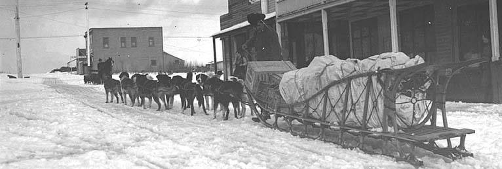

<p align="center">
  
</p>

# Sled 🛷

NixOS Atomic Model Context Protocol (MCP) Store & Server Bridge for the SpanishSyntax & Frost Ecosystem.

[](https://github.com/SpanishSyntax/Sled/blob/main/LICENSE)
[](https://github.com/SpanishSyntax/Sled/blob/main/flake.nix)
[](https://github.com/SpanishSyntax/Sled/blob/main/pyproject.toml)

`Sled` is a Model Context Protocol (MCP) server bridge and store built for the **Frost** NixOS ecosystem alongside `Basecamp`, `Rime`, `Snowpack`, `Borealis`, `Barograph`, and `Goggles`.

Instead of monolithic macro-tools or high-friction shell abstractions, Sled atomizes host capabilities into focused, deterministic Unix, Git, System, Docker, Systemd, NixOS, and Network primitives (`ls`, `cat`, `grep`, `git_status`, `ps`, `df`, `docker_ps`, `journalctl`, `nix_search`).

---

## Why "Sled"? (The Lore)

> **sled** (`/slɛd/`) — *noun:* The rugged, low-friction wooden vehicle built to haul essential survival cargo, precision scientific instruments, and heavy supplies across trackless snow without bogging down.

You cannot traverse polar glaciers in heavy wheeled trucks; only a flexible, low-friction sled distributes weight evenly across the crust and keeps cargo moving forward through the deepest drifts.

**Sled carries atomic tools to AI coding agents:**
- **Low-Friction Hauling**: Bridges Model Context Protocol (MCP) clients with lightweight, atomic inspection tools.
- **Hermetic Stream Separation**: Isolates JSON-RPC 2.0 communication on standard input/output from diagnostic logs, avoiding shell escape corruption and delivering deterministic responses directly into agent contexts.

---

## Architecture Highlights

- **Dual-Mode Store**: Manage tools at the aggregate pack level (`sled store`) or granular tool level (`sled store tools`).
- **Zero-Trust Security**: No tools or packs are active out of the box until explicitly declared in `~/.config/sled/sled.toml`.
- **Strict Stdio Separation**: `stdout` is reserved strictly for JSON-RPC 2.0 payloads; all logging, UI elements, and diagnostics route to `stderr`.
- **In-Memory Local Search**: Instant local catalog query across tools, packs, parameters, and descriptions with zero network requests.
- **Polyglot Atomic Tooling**: Over 70 built-in primitives spanning filesystem inspection, git mechanics, system metrics, container lifecycles, and Nix flake evaluations.
- **Live Out-of-Store Symlinking**: Integrates with Frost via `mkOutOfStoreSymlink` to permit immediate configuration changes without NixOS system rebuilds.

---

## Quick Demo

```bash
# Launch the interactive store TUI
sled store

# Search for atomic tools matching "log"
sled search log

# Execute an atomic tool directly from the terminal
sled run ls path=. all_files=false

# Start the MCP stdio bridge for client connections
sled serve
```

---

## Table of Contents

- [Getting Started](getting-started.md)
  - [Installation](getting-started.md#installation)
  - [Quick Start](getting-started.md#quick-start)
  - [MCP Client Configuration](getting-started.md#mcp-client-configuration)
  - [NixOS & Frost Integration](getting-started.md#nixos--frost-integration)
- [Architecture & Design](architecture.md)
  - [System Philosophy](architecture.md#system-philosophy)
  - [The Lore: The Arctic Sled](architecture.md#why-sled-the-lore)
  - [Stdio Stream Discipline](architecture.md#stdio-stream-discipline)
  - [Zero-Trust Security & Whitelisting](architecture.md#zero-trust-security--whitelisting)
  - [Dual-Mode Store Engine](architecture.md#dual-mode-store-engine)
- [Atomic Tools Reference](tools.md)
  - [Filesystem Pack (fs)](tools.md#filesystem-pack-fs)
  - [Git Repository Pack (git)](tools.md#git-repository-pack-git)
  - [System & Host Pack (system)](tools.md#system--host-pack-system)
  - [Docker & Container Pack (docker)](tools.md#docker--container-pack-docker)
  - [Systemd & Journald Pack (systemd)](tools.md#systemd--journald-pack-systemd)
  - [NixOS & Flake Pack (nixos)](tools.md#nixos--flake-pack-nixos)
  - [Network & Sockets Pack (network)](tools.md#network--sockets-pack-network)
  - [Development Toolchain Pack (dev)](tools.md#development-toolchain-pack-dev)
  - [External Application Bridges](tools.md#external-application-bridges)
- [Integration & Usage Guide](usage.md)
  - [Interactive Store & TUI](usage.md#interactive-store--tui)
  - [CLI Management Recipes](usage.md#cli-management-recipes)
  - [Direct Tool Execution](usage.md#direct-tool-execution)
  - [Client Integration](usage.md#client-integration)
